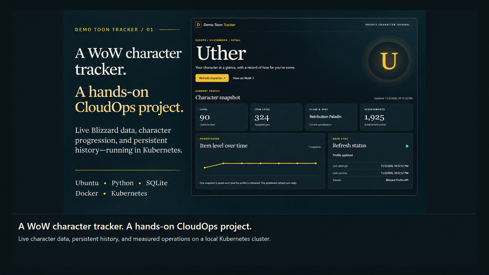
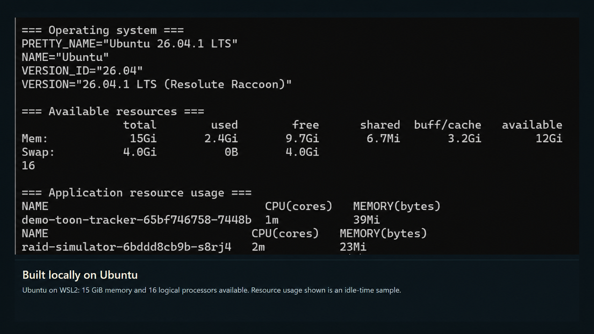
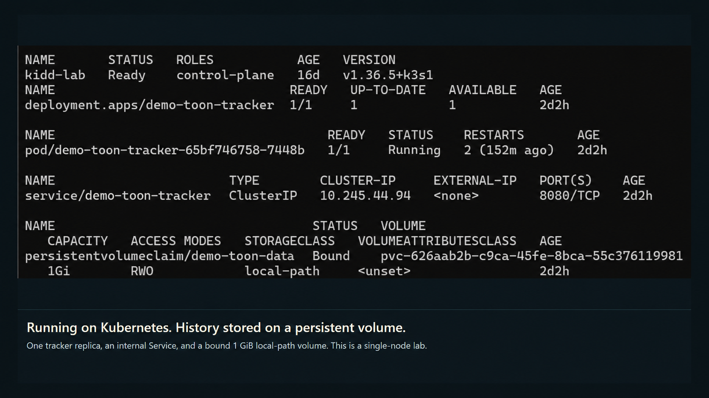
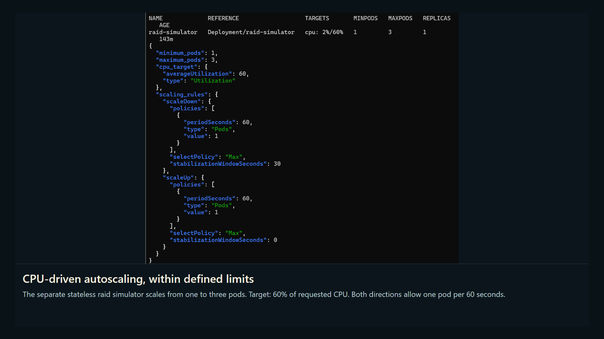
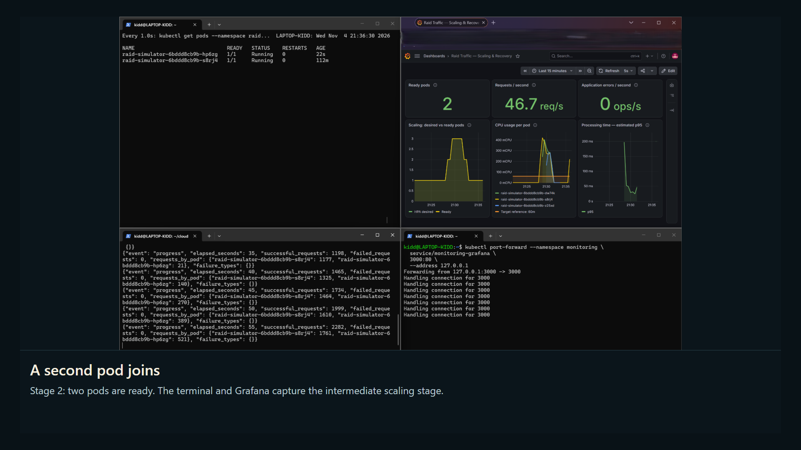
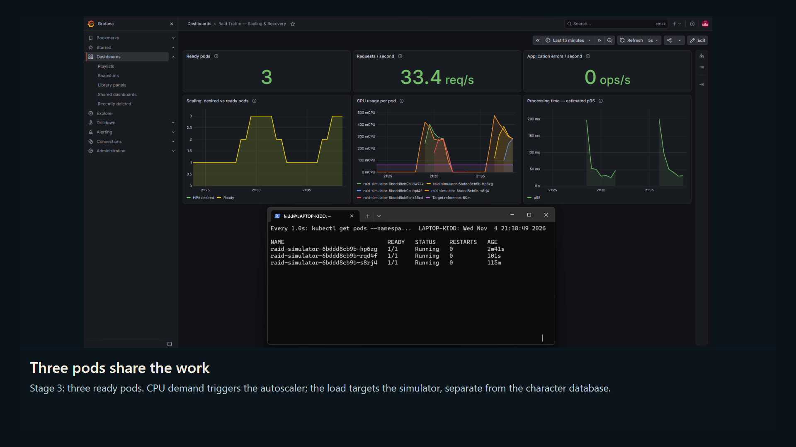
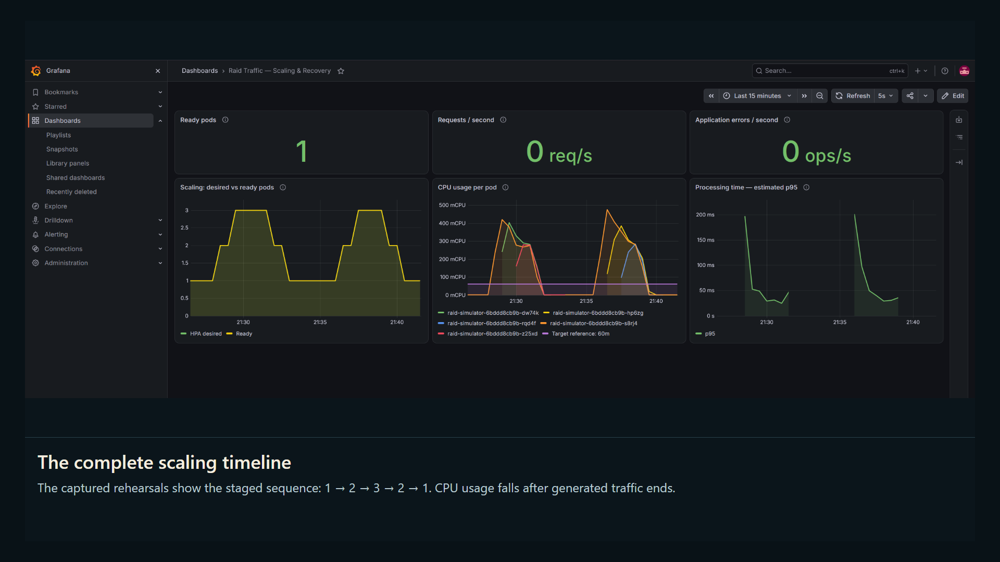

# Demo Toon Tracker

Demo Toon Tracker is a World of Warcraft character tracker that I built as a CloudOps learning project.

The goal was not just to build an application, but to learn how to deploy, monitor, back up, and manage it on Kubernetes. The project runs on a local K3s cluster and uses a SQLite database to store character history over time.

To make learning more enjoyable, I often build projects around interests outside of work. In this case, I used World of Warcraft as the theme while focusing on cloud infrastructure, monitoring, automation, and operational practices.

## Technologies Used

- Kubernetes (K3s)
- Docker
- Python
- SQLite
- Grafana
- GitHub
- Linux

## Features

- View World of Warcraft character information using the Blizzard API
- Save character snapshots and track item level changes over time
- Store data on a Kubernetes persistent volume
- Create and validate scheduled database backups
- Test Kubernetes auto-scaling using a separate raid simulator
- Monitor application and infrastructure metrics using Grafana

## Project Goals

This project was created to help me gain hands-on experience running applications on Kubernetes.

During development I focused on:

- Containerizing applications with Docker
- Deploying workloads to Kubernetes
- Using persistent storage
- Creating backup and recovery procedures
- Learning Kubernetes scaling behavior
- Building monitoring dashboards with Grafana
- Troubleshooting containers and cluster resources

The application itself is intentionally simple. The primary goal was to learn and practice the infrastructure and operational side of running modern cloud workloads.

## Running the Project

### Run with Sample Data

Install Python 3.11 or newer.

**Linux / macOS**

```bash
DEMO_MODE=true HOST=127.0.0.1 PORT=8080 python3 -m app.main
```

**Windows PowerShell**

```powershell
$env:DEMO_MODE = 'true'
$env:HOST = '127.0.0.1'
$env:PORT = '8080'
python -m app.main
```

Open:

http://127.0.0.1:8080

### Run with Docker

```bash
docker build -t demo-toon-tracker:demo .
docker run --rm -p 127.0.0.1:8080:8080 -e DEMO_MODE=true -v demo-toon-demo-data:/data demo-toon-tracker:demo
```

The Docker volume preserves the application data after the container is stopped.

### Run the Tests

```bash
python3 -m unittest discover -s tests -v
```

On Windows, use `python` instead of `python3`.

### Use Live Blizzard Data

Create a client in the Battle.net Developer Portal and configure:

```bash
BLIZZARD_CLIENT_ID
BLIZZARD_CLIENT_SECRET
DEMO_MODE=false
```

The block above lists the settings. Set `BLIZZARD_CLIENT_ID` and `BLIZZARD_CLIENT_SECRET` to your own values in your local environment before starting the tracker.

Keep credentials outside of Git and store them securely.

## Project Demo

The screenshots below show the application, infrastructure, backup testing, monitoring, and Kubernetes scaling demonstrations performed in my local lab environment.



<details>
<summary>View additional screenshots</summary>


















</details>

For additional details, see the project documentation in the `/docs` directory.

[Download the interactive slideshow](docs/demo/slideshow.zip?raw=true).
Unzip it, open `index.html` in your browser, and use the arrow keys to move through the slides.

[Read the demo notes](docs/demo/README.md) for the test results.
