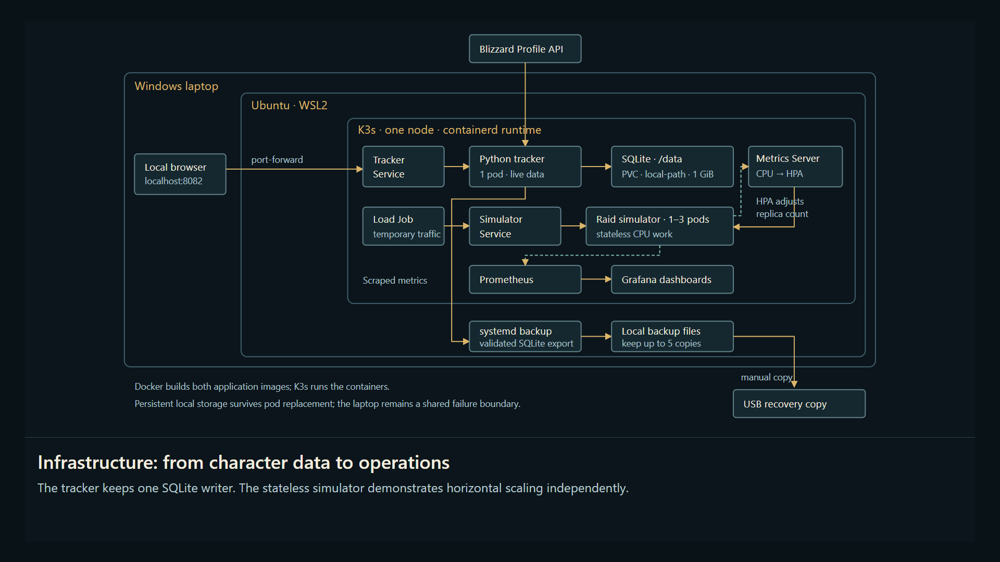
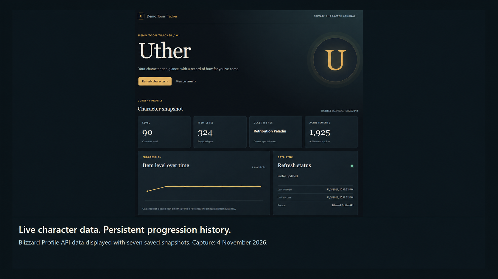
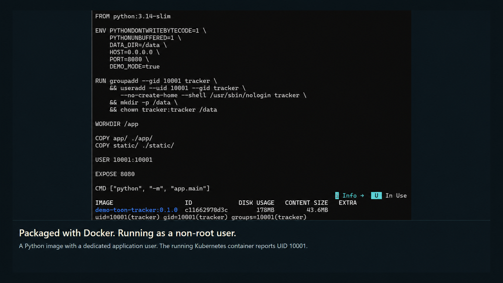
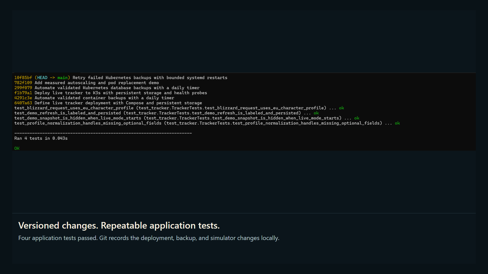
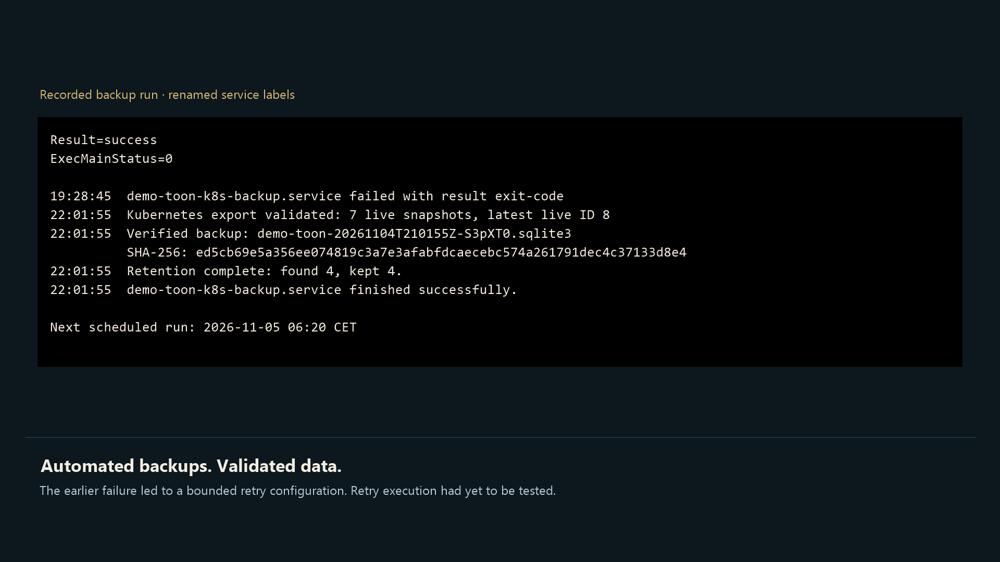
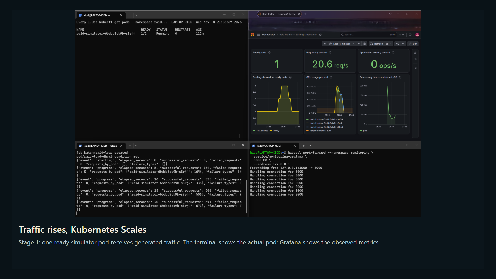
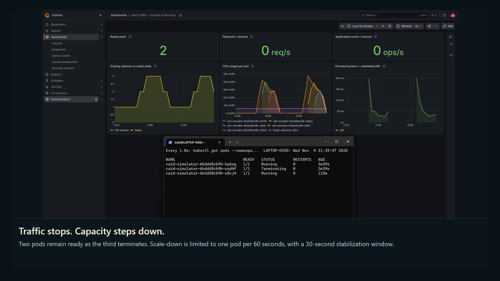
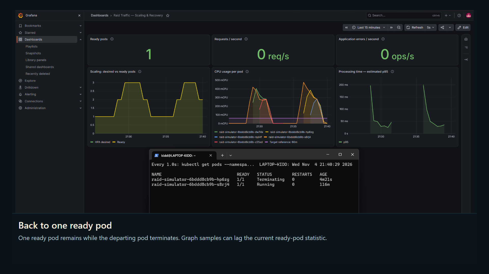
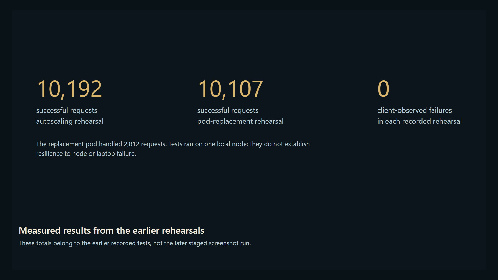

# NAME

**Demo Toon Tracker** is a World of Warcraft character tracker and a CloudOps practice project. It shows a character’s current stats and saves a history of changes. I built and ran the project on a local Kubernetes cluster.

I ran this project on my laptop. The preview below shows recorded tests from that local setup.

## FEATURES

- View character stats from the Blizzard Profile API or try the app with sample data.
- Save character snapshots in SQLite and see how item level changes over time.
- Keep the database on a Kubernetes persistent volume so the data stays available when the tracker pod is replaced.
- Create scheduled database backups and check that the backup files are readable.
- Use a separate raid simulator to test how Kubernetes adds and removes pods as CPU use changes.
- View request rates, errors, CPU use, and pod counts in Grafana.

## THE PROCESS

1. I started with a Python app and a SQLite database. I added tests for the API request, saved snapshots, and missing profile fields.
2. I used Docker to build a container image and deployed it to K3s, a version of Kubernetes. The tracker runs as a regular user inside the container.
3. I moved the database to persistent storage and tested that the tracker could read a restored backup.
4. I ran a separate simulator under load. Kubernetes scaled it from one pod to three and back to one. I also removed a pod during a separate test and watched Kubernetes replace it.

The tracker runs as one pod on my laptop. The simulator can run several copies because it does not store character data. [Read the demo notes](docs/demo/README.md).

## RUNNING THE PROJECT

### Try the tracker with sample data

Install Python 3.11 or newer. Open a terminal in the project folder and run the commands for your system.

**Linux or macOS**

```bash
DEMO_MODE=true HOST=127.0.0.1 PORT=8080 python3 -m app.main
```

**Windows PowerShell**

```powershell
$env:DEMO_MODE = 'true'
$env:HOST = '127.0.0.1'
$env:PORT = '8080'
python -m app.main
```

Open <http://127.0.0.1:8080> in your browser. Press **Ctrl+C** in the terminal to stop the app. Sample mode works without a Blizzard account or API credentials.

### Run the tracker with Docker

With Docker running, build the image from the project folder and start the container.

```bash
docker build -t demo-toon-tracker:demo .
docker run --rm -p 127.0.0.1:8080:8080 -e DEMO_MODE=true -v demo-toon-demo-data:/data demo-toon-tracker:demo
```

Open the same local address in your browser. The Docker volume keeps sample history after the container stops.

### Run the application tests

```bash
python3 -m unittest discover -s tests -v
```

On Windows, use `python` in place of `python3`.

### Use live character data

Create a client in the [Battle.net Developer Portal](https://community.developer.battle.net/). Set `DEMO_MODE=false` and provide `BLIZZARD_CLIENT_ID` and `BLIZZARD_CLIENT_SECRET` in your local environment before starting the app. Keep your credentials out of Git.

## PREVIEW

The 16 slides show the app, the Kubernetes setup, the backup process, and the scaling test.


<details>
<summary>View slides 2–16</summary>























</details>

For a slide-by-slide view, [download the interactive slideshow](docs/demo/slideshow.zip?raw=true). Unzip it and open `index.html` in your browser. Use the arrow keys to move through the slides.
